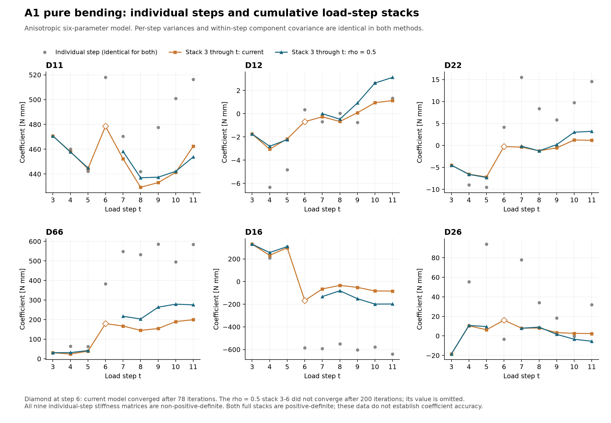
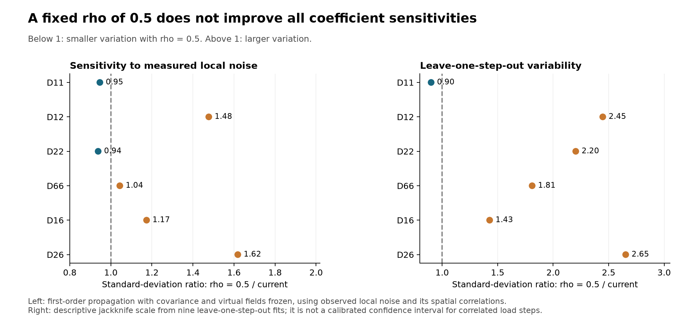

# A1_PB: current covariance versus fixed load-step correlation rho = 0.5

## Conclusion

A fixed correlation of 0.5 describes the previously measured fast-noise correlations much better than the degree-6 spatial residuals, but it is **not a uniformly better coefficient estimator** in this A1-only, six-parameter anisotropic fit.

Single-step estimates are identical under both methods. For the full load-step stack, D11 changes from 462.424 to 453.768 N mm (-1.87%). Other coefficients change substantially. The fixed-0.5 model modestly improves D11 sensitivity, but increases leave-one-step-out variability for the other five coefficients. Both full-stack stiffness matrices are positive-definite, while all nine standalone-step fits are non-positive-definite. These outcomes limit any claim of material-parameter accuracy from A1_PB alone.

No independent ground-truth stiffness is available in this comparison. A smaller residual under each method's own whitening covariance is not a fair accuracy ranking because the weights differ.

## Controlled comparison

Used A1_PB from the saved `VFM Studio/Generalized VFM/projects/deg45_all.vfmproj.json` project: load steps 3-11, 5,811 mapped material points, the saved 2x2 virtual mesh, boundary conditions, material orientation, applied loads and area weights. The material law remains anisotropic with coefficient order (D11, D12, D22, D66, D16, D26), all in N mm. No other experiments were stacked with A1_PB.

Both approaches use the same initial parameters [400, 50, 400, 100, 50, 50], parameter convergence tolerance 1e-8, covariance tolerance 1e-4 and primary iteration limit 40. Spatial correction remains off, as in the saved project. Covariance overrides use the solver's existing interface; application code was not changed.

**The per-step variances and complete 3x3 within-step component covariance blocks are exactly unchanged.** Therefore this is a sensitivity study of the between-step model, not a full replacement of the degree-6 effective-error covariance with the static-noise calibration. Its marginal variances can still include unresolved mechanics and slow error.

### What rho = 0.5 means here

A median alone does not define a covariance matrix. The primary alternative sets the same-component correlation to exactly 0.5 for every distinct pair of load steps. For the remaining between-step cross-component entries, let S_t be the original within-step covariance, D_t its diagonal standard-deviation matrix, R_t=D_t^-1 S_t D_t^-1, and Rbar the average R_t over the steps included in that run. Set

    Gamma_tt = S_t,
    Gamma_ts = 0.5 * D_t * Rbar * D_s,  t != s.

This preserves all within-step entries. Positive definiteness was verified, including the positive-definite independent remainder R_t - 0.5*Rbar. It represents common correlated factors with step-dependent amplitudes plus an independent remainder. It does not assert that the physical reference covariance is identical to these modeled common factors.

For cumulative and leave-one-out runs, Rbar is computed using only the included steps. The current estimator uses the corresponding principal submatrix of its original Gamma; this equals re-estimation on the selected steps because its spatial projection and normalization do not depend on how many steps are included.

## Independent step values and the full stack

Each individual step below is solved independently to convergence, including re-optimization of its virtual fields. They are **not** the per-step right-hand-side values evaluated at the final stacked virtual fields. The latter depend on the stacked solution and are saved separately in `initial_full_comparison.json`.

Both covariance approaches produce exactly the same independently solved values because there are no between-step blocks in a one-step problem.

| Case | D11 | D12 | D22 | D66 | D16 | D26 |
|---|---:|---:|---:|---:|---:|---:|
| Step 3, both | 470.723 | -1.749 | -4.495 | 30.918 | 330.128 | -18.581 |
| Step 4, both | 460.058 | -6.336 | -8.981 | 64.217 | 209.072 | 55.392 |
| Step 5, both | 442.277 | -4.815 | -9.525 | 62.226 | 307.421 | 93.871 |
| Step 6, both | 517.911 | 0.340 | 4.178 | 383.341 | -583.859 | -3.410 |
| Step 7, both | 470.439 | -0.687 | 15.480 | 548.096 | -591.585 | 77.767 |
| Step 8, both | 442.001 | 0.032 | 8.383 | 532.297 | -551.541 | 34.179 |
| Step 9, both | 477.638 | -0.764 | 5.849 | 585.511 | -603.126 | 18.336 |
| Step 10, both | 501.052 | 2.640 | 9.729 | 495.335 | -578.441 | -0.490 |
| Step 11, both | 516.219 | 1.325 | 14.531 | 584.113 | -640.238 | 31.864 |
| **Stack 3-11, current** | **462.424** | **1.132** | **1.165** | **199.532** | **-83.776** | **2.382** |
| **Stack 3-11, rho=0.5** | **453.768** | **3.125** | **3.217** | **275.623** | **-198.226** | **-5.470** |

Both full stacks converged: current in 9 iterations and rho=0.5 in 10. Their stiffness-matrix eigenvalues are respectively (1.126, 175.144, 486.852) and (3.105, 147.434, 582.069) N mm. Positive definiteness alone does not establish that the coefficients are accurate.

All standalone-step matrices have at least one non-positive eigenvalue. Several transverse/coupling estimates change strongly across steps. These are diagnostic numerical fits, not individually reliable complete material characterizations.

## Cumulative load-step stacks

A row labeled “through t” includes steps 3,4,...,t. All entries have units N mm.

| Through step | Method | D11 | D12 | D22 | D66 | D16 | D26 | Status |
|---|---|---:|---:|---:|---:|---:|---:|---|
| 3 | current | 470.723 | -1.749 | -4.495 | 30.918 | 330.128 | -18.581 | Converged, 7 iterations |
| 3 | rho05 | 470.723 | -1.749 | -4.495 | 30.918 | 330.128 | -18.581 | Converged, 7 iterations |
| 4 | current | 458.053 | -3.059 | -6.537 | 24.043 | 231.741 | 10.404 | Converged, 18 iterations |
| 4 | rho05 | 457.767 | -2.804 | -6.585 | 31.525 | 256.022 | 10.691 | Converged, 14 iterations |
| 5 | current | 444.308 | -2.167 | -7.171 | 38.819 | 298.563 | 6.235 | Converged, 15 iterations |
| 5 | rho05 | 445.005 | -2.236 | -7.304 | 41.750 | 308.736 | 9.566 | Converged, 13 iterations |
| 6 | current | 478.572 | -0.687 | -0.258 | 179.760 | -167.629 | 16.112 | Converged, 78 iterations; extended check |
| 6 | rho05 | — | — | — | — | — | — | Not converged at 200; extended check |
| 7 | current | 452.233 | -0.269 | -0.389 | 167.209 | -65.154 | 7.928 | Converged, 13 iterations |
| 7 | rho05 | 458.227 | 0.001 | -0.190 | 217.284 | -132.808 | 7.858 | Converged, 28 iterations |
| 8 | current | 429.311 | -0.672 | -1.225 | 145.182 | -33.983 | 8.073 | Converged, 12 iterations |
| 8 | rho05 | 436.978 | -0.471 | -1.234 | 203.101 | -81.245 | 9.018 | Converged, 12 iterations |
| 9 | current | 433.073 | 0.085 | -0.566 | 154.361 | -51.144 | 3.343 | Converged, 11 iterations |
| 9 | rho05 | 437.435 | 0.921 | 0.171 | 263.542 | -151.213 | 1.605 | Converged, 14 iterations |
| 10 | current | 441.344 | 0.944 | 1.235 | 189.971 | -83.089 | 2.636 | Converged, 10 iterations |
| 10 | rho05 | 442.159 | 2.638 | 3.005 | 278.977 | -198.965 | -3.411 | Converged, 9 iterations |
| 11 | current | 462.424 | 1.132 | 1.165 | 199.532 | -83.776 | 2.382 | Converged, 9 iterations |
| 11 | rho05 | 453.768 | 3.125 | 3.217 | 275.623 | -198.226 | -5.470 | Converged, 10 iterations |

The steps 3-6 stack did not converge within the primary 40-iteration limit under either model. An otherwise identical extension to 200 iterations converged after 78 iterations for the current covariance. The rho=0.5 run still had not converged at 200. Its last iterate is retained in the raw diagnostics, but omitted from the coefficient table and plot. This is a result for the saved initial guess, not proof that no other initialization can converge.

## Is rho=0.5 closer to measured noise?

Yes, for the fast-noise component measured in the preceding static/local-window study. Compared the 36 off-diagonal entries of each component's 9x9 correlation matrix with that observed local-noise matrix:

| Component | Current correlation RMSE | Fixed-0.5 correlation RMSE |
|---|---:|---:|
| kxx | 0.1899 | 0.0265 |
| kyy | 0.1501 | 0.0472 |
| kxy | 0.1846 | 0.0431 |

The previous local-noise study uses 5,805 common points rather than the solver's original 5,811; six facets are missing from some neighboring raw frames. The fixed-0.5 model clearly agrees better with that fast-noise correlation pattern. This does not imply that it represents slow drift or the mechanical structure included in the current spatial residuals.

## Effect on coefficient sensitivity

### Leave-one-load-step-out check

Refitted all eight remaining steps after omitting each of the nine steps, with the same initial guess and settings. All 18 fits converged. The table gives the descriptive jackknife scale

    sqrt((T-1)/T * sum_t (theta_without_t - mean(theta_without_t))^2).

Because the load steps are correlated and have different loads, this is a stability diagnostic rather than a calibrated standard error.

| Coefficient | Current | rho=0.5 | Ratio, rho=0.5/current |
|---|---:|---:|---:|
| D11 | 20.480 | 18.445 | 0.901 |
| D12 | 1.492 | 3.651 | 2.447 |
| D22 | 2.929 | 6.454 | 2.204 |
| D66 | 47.263 | 85.585 | 1.811 |
| D16 | 98.551 | 140.716 | 1.428 |
| D26 | 4.601 | 12.208 | 2.654 |

D11 improves modestly: its leave-one-out range is 441.344-467.093 N mm under the current model and 442.159-468.929 N mm under rho=0.5; the jackknife scale falls by 9.9%. The other five jackknife scales increase. The largest D11 departure from its own full-stack estimate falls from 21.081 to 15.160 N mm.

The rho=0.5 model does improve one physical-admissibility check: all nine leave-one-out stiffness matrices are positive-definite, versus eight of nine for the current model. That improvement coexists with larger coefficient variability.

### Sensitivity to observed local noise, including spatial correlations

Propagated the actual neighboring-frame fluctuation fields from the previous study through each converged estimator's frozen linearization. This retains their measured spatial and component correlations; it does not replace them with independent synthetic pixel noise.

Used the general fixed-covariance derivative of theta=(H^T W H)^-1 H^T W b, including both dH terms when the equilibrium residual is nonzero. Checked the derivative against central finite differences of the solver's frozen-field identification interface; relative discrepancies were below 5e-9. The covariance and virtual fields are held fixed, so their re-estimation uncertainty is excluded.

Only the 5,805 common facets are perturbed; the six unavailable facets are held fixed. The nine temporal offsets have seven residual degrees of freedom after local linear detrending. The values below describe local first-order sensitivity, not full uncertainty or accuracy bounds.

| Coefficient | Current local-noise SD | rho=0.5 local-noise SD | Ratio |
|---|---:|---:|---:|
| D11 | 4.441 | 4.203 | 0.946 |
| D12 | 0.684 | 1.010 | 1.477 |
| D22 | 2.040 | 1.914 | 0.938 |
| D66 | 46.899 | 48.946 | 1.044 |
| D16 | 28.106 | 32.998 | 1.174 |
| D26 | 2.068 | 3.348 | 1.618 |

The fixed-0.5 model reduces this sensitivity by about 5.4% for D11 and 6.2% for D22, but increases it for D12, D66, D16 and D26. It is therefore not uniformly more efficient even in this limited local-noise check.

## Why the precise meaning of “median rho = 0.5” matters

Two sensitivity checks confirm the distinction between a median and a complete covariance model:

1. Replacing the pooled shared component correlation Rbar by the identity while retaining the original within-step blocks gives [453.855, 3.165, 3.300, 276.417, -199.345, -5.507] N mm. This is close to the main constant-0.5 result, so that particular cross-component choice does not drive the large shifts.
2. Preserving the original between-step pattern and multiplying all between-step blocks by 0.756906 makes the median over the 108 same-component step-pair correlations equal to 0.5. The full-stack result is [458.744, 1.558, 1.675, 234.741, -140.512, 0.986] N mm. It differs from imposing a constant 0.5 on every pair. Within-step blocks remain unchanged and the covariance remains positive-definite.

Thus a request to change only the median leaves the estimator under-specified. The primary comparison above uses the explicit constant-correlation construction.

## Practical interpretation

For fast DIC noise, rho around 0.5 has much stronger support from the static and local-frame data than the current spatial-fit correlations. For material identification, this A1-only comparison does not support a blanket claim that substituting 0.5 gives better constants. The change is modest for D11 but substantial and less stable for several other coefficients.

The appropriate next comparison would use enough independent loading configurations to constrain the six anisotropic coefficients and distinguish the measurement-noise covariance from slower error or mechanical discrepancy. Replacing only rho while retaining degree-6 marginal variances remains an intentionally limited sensitivity test.

## Reproducibility and unchanged code

- `single_step_and_full_stack.csv`: the directly requested coefficient table, at full precision.
- `cumulative_stack.csv`: progressive stacks, with convergence flags.
- `all_runs.json`: primary fits, model-based standard errors, stiffness eigenvalues and convergence diagnostics.
- `supplemental_checks.json`: the extended-iteration and median-only checks.
- `covariance_inputs.npz`: both full covariance matrices, unchanged within-step blocks and the shared component correlation.
- `local_noise_propagation.json`: conditional measurement-noise sensitivity results.
- `comparison_diagnostics.json`: leave-one-out scales and correlation-model comparisons.

Verified that all 177 checked existing Python/TOML source files remained byte-for-byte unchanged. The within-step covariance difference and the independently solved step-coefficient differences are both exactly zero. Results were produced by the existing solver with in-memory covariance overrides; no application or project files were edited.
