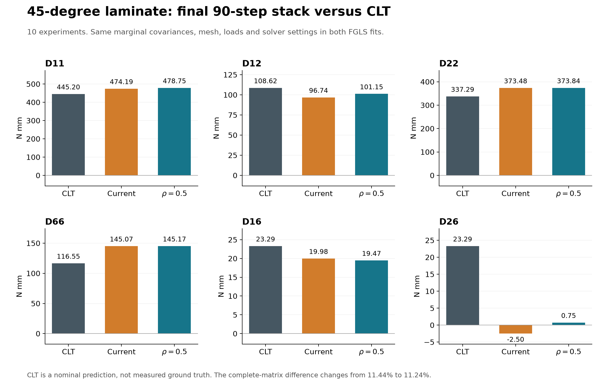
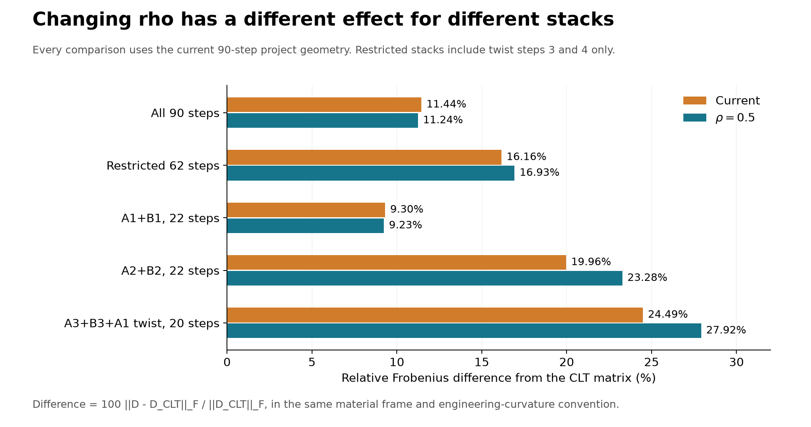

# 45-degree laminate: current covariance versus rho = 0.5, compared with CLT

## Result

Replacing the current between-step correlations with rho=0.5 does **not consistently bring the identified stiffness closer to CLT**. For the full current project (10 experiments, 90 load steps), the matrix difference falls slightly from **11.440% to 11.240%**. D12 and D26 move closer to CLT; D11, D22, D66 and D16 move farther away. In the restricted 62-step comparison the matrix difference instead rises from **16.160% to 16.930%**.

Among the eight individual experiments that converge under both methods, the full-matrix difference improves in three (A2_PB, A3_PB and A2_Twist) and worsens in five. Most experiment-only fits are not positive-definite, so these are diagnostic six-parameter fits rather than reliable standalone characterizations. CLT is a nominal benchmark, not independently measured ground truth.

The analysis is limited to the **45-degree laminate**, as requested. No cross-ply results are included. No application code or saved projects were changed.

## Final stack: all 90 current-project load steps

All stiffness values are N mm. Deviations are signed: 100*(identified-CLT)/CLT.

| Coefficient | CLT | Current | rho=0.5 | Current deviation | rho=0.5 deviation |
|---|---|---|---|---|---|
| D11 | 445.198 | 474.190 | 478.751 | +6.51% | +7.54% |
| D12 | 108.619 | 96.744 | 101.151 | -10.93% | -6.88% |
| D22 | 337.295 | 373.484 | 373.840 | +10.73% | +10.84% |
| D66 | 116.549 | 145.071 | 145.174 | +24.47% | +24.56% |
| D16 | 23.293 | 19.977 | 19.471 | -14.24% | -16.41% |
| D26 | 23.293 | -2.498 | 0.747 | -110.73% | -96.79% |

Both fits converge in 7 iterations and give positive-definite stiffness matrices. The largest persistent discrepancies are D66 (approximately +24.5%) and D26 (approximately -110.7% versus -96.8%). The positive sign recovered for D26 with rho=0.5 is an improvement relative to the positive CLT value, but its magnitude remains only 0.747 N mm versus 23.293 N mm.

## Every experiment, stacked over its own nine load steps

Every row uses the six-parameter anisotropic law, with the other experiments excluded. Steps 3-11 are included for both pure bending and twist. A one-experiment fit does not benefit from the complementary loading of the final combined stack.

| Experiment | Method | D11 | D12 | D22 | D66 | D16 | D26 |
|---|---|---|---|---|---|---|---|
| A1_PB | Current | 462.424 | 1.132 | 1.165 | 199.532 | -83.776 | 2.382 |
| A1_PB | rho=0.5 | 453.768 | 3.125 | 3.217 | 275.623 | -198.226 | -5.470 |
| A2_PB | Current | 554.709 | -7.198 | -9.500 | 225.556 | -195.493 | 8.453 |
| A2_PB | rho=0.5 | 559.124 | -7.145 | -10.075 | 246.919 | -182.532 | 2.572 |
| A3_PB | Current | 529.535 | 0.143 | 0.099 | 12.249 | 0.089 | 0.035 |
| A3_PB | rho=0.5 | 537.906 | -0.079 | -0.198 | 59.312 | 6.972 | -0.124 |
| B1_PB | Current | -4.399 | -1.531 | 362.878 | 201.298 | -3.369 | -11.291 |
| B1_PB | rho=0.5 | -5.294 | -2.087 | 350.636 | 219.847 | -5.935 | -16.888 |
| B2_PB | Current | -52.082 | -17.613 | 353.718 | 493.384 | -68.360 | -132.897 |
| B2_PB | rho=0.5 | -69.738 | -22.886 | 352.038 | 556.234 | -88.989 | -143.916 |
| B3_PB | Current | — | — | — | — | — | — |
| B3_PB | rho=0.5 | -0.299 | -0.143 | 426.592 | -11.735 | 1.672 | 0.184 |
| A1_Twist | Current | — | — | — | — | — | — |
| A1_Twist | rho=0.5 | — | — | — | — | — | — |
| A2_Twist | Current | -401.239 | -392.288 | 0.595 | 169.459 | 13.830 | 19.871 |
| A2_Twist | rho=0.5 | -361.836 | -401.685 | 53.728 | 171.585 | -41.007 | 24.917 |
| B1_Twist | Current | -6.376 | -254.993 | -12.778 | 134.932 | -27.918 | 95.939 |
| B1_Twist | rho=0.5 | -20.759 | -285.882 | -18.799 | 135.967 | -30.932 | 105.800 |
| B2_Twist | Current | 2.575 | -578.393 | -1634.181 | 184.152 | 33.973 | -672.319 |
| B2_Twist | rho=0.5 | 53.935 | -647.788 | -1936.646 | 187.432 | 37.855 | -728.395 |

A dash means that no converged result is available under the stated settings. In particular, the last iterate of the nonconvergent B3_PB current fit is not presented as a stiffness estimate. Raw last iterates and error messages remain in the diagnostics.

### Convergence, physical admissibility and CLT matrix difference

The comparison metric is 100*||D-D_CLT||_F/||D_CLT||_F for the symmetric 3x3 matrix in the material frame. This counts off-diagonal terms twice through their two matrix entries. It provides one explicit overall measure; it does not replace the individual coefficient comparisons or establish estimator accuracy. A positive-definite matrix is necessary for a stable elastic bending law but does not guarantee agreement with the material.

| Experiment | Current matrix difference | rho=0.5 matrix difference | Current status | rho=0.5 status | Current positive-definite | rho=0.5 positive-definite |
|---|---|---|---|---|---|---|
| A1_PB | 68.96% | 85.87% | Converged, 9 iterations | Converged, 10 iterations | Yes | Yes |
| A2_PB | 87.20% | 86.53% | Converged, 12 iterations | Converged, 11 iterations | No | No |
| A3_PB | 66.93% | 65.57% | Converged, 153 iterations (extended from 40) | Converged, 16 iterations | Yes | No |
| B1_PB | 82.32% | 83.21% | Converged, 12 iterations | Converged, 13 iterations | No | No |
| B2_PB | 117.74% | 127.87% | Converged, 14 iterations | Converged, 15 iterations | No | No |
| B3_PB | Unavailable | 84.11% | Not converged at 200; coefficients omitted | Converged, 27 iterations | Unavailable | No |
| A1_Twist | Unavailable | Unavailable | Failed: equation covariance factorization | Failed: equation covariance factorization | Unavailable | Unavailable |
| A2_Twist | 194.91% | 189.67% | Converged, 20 iterations | Converged, 15 iterations | No | No |
| B1_Twist | 131.45% | 138.62% | Converged, 16 iterations | Converged, 14 iterations | No | No |
| B2_Twist | 413.23% | 465.22% | Converged, 13 iterations | Converged, 32 iterations | No | No |

A1_Twist alone fails in the equation-covariance Cholesky factorization under both methods. The supplied kinematic covariance matrices are positive-definite; the failure occurs in the propagated equation covariance during this weak six-parameter fit. No regularization, coefficient constraints or data exclusion was introduced to force a result.

A3_PB current requires 153 iterations to converge, beyond the saved 40-iteration limit. B3_PB current remains unconverged at 200. The primary 40-iteration outcome is retained separately for each run.

### Signed coefficient deviations from CLT

Percentages can be large for coupling coefficients because their CLT values are small. The preceding table of absolute stiffnesses is therefore essential to interpreting this table.

| Experiment | Method | D11 | D12 | D22 | D66 | D16 | D26 |
|---|---|---|---|---|---|---|---|
| A1_PB | Current | +3.87% | -98.96% | -99.65% | +71.20% | -459.66% | -89.78% |
| A1_PB | rho=0.5 | +1.93% | -97.12% | -99.05% | +136.49% | -951.02% | -123.48% |
| A2_PB | Current | +24.60% | -106.63% | -102.82% | +93.53% | -939.28% | -63.71% |
| A2_PB | rho=0.5 | +25.59% | -106.58% | -102.99% | +111.86% | -883.64% | -88.96% |
| A3_PB | Current | +18.94% | -99.87% | -99.97% | -89.49% | -99.62% | -99.85% |
| A3_PB | rho=0.5 | +20.82% | -100.07% | -100.06% | -49.11% | -70.07% | -100.53% |
| B1_PB | Current | -100.99% | -101.41% | +7.58% | +72.72% | -114.46% | -148.47% |
| B1_PB | rho=0.5 | -101.19% | -101.92% | +3.96% | +88.63% | -125.48% | -172.50% |
| B2_PB | Current | -111.70% | -116.22% | +4.87% | +323.33% | -393.48% | -670.55% |
| B2_PB | rho=0.5 | -115.66% | -121.07% | +4.37% | +377.25% | -482.04% | -717.86% |
| B3_PB | Current | — | — | — | — | — | — |
| B3_PB | rho=0.5 | -100.07% | -100.13% | +26.47% | -110.07% | -92.82% | -99.21% |
| A1_Twist | Current | — | — | — | — | — | — |
| A1_Twist | rho=0.5 | — | — | — | — | — | — |
| A2_Twist | Current | -190.13% | -461.16% | -99.82% | +45.40% | -40.62% | -14.69% |
| A2_Twist | rho=0.5 | -181.28% | -469.81% | -84.07% | +47.22% | -276.05% | +6.97% |
| B1_Twist | Current | -101.43% | -334.76% | -103.79% | +15.77% | -219.86% | +311.88% |
| B1_Twist | rho=0.5 | -104.66% | -363.20% | -105.57% | +16.66% | -232.80% | +354.22% |
| B2_Twist | Current | -99.42% | -632.50% | -584.50% | +58.00% | +45.85% | -2986.37% |
| B2_Twist | rho=0.5 | -87.89% | -696.38% | -674.17% | +60.82% | +62.52% | -3227.12% |

## Restricted load-step and specimen stacks

The current `deg45_all.vfmproj.json` has 90 steps, whereas the older exported campaign results used 62: nine bending steps per experiment but only twist steps 3 and 4. To separate covariance effects from step-selection effects, the restricted comparisons below use the **current main-project meshes and settings** for both methods, changing only the included steps/experiments.

These are fresh controlled comparisons. They are not literal replays of the old result files or of the separate subgroup projects: all 22/22/20 test entries in those subgroup projects have mesh settings different from their counterparts in the current main project. The old exported 62-step stack reported D11=501.848 N mm; our controlled 62-step rerun gives 514.369 N mm under the current project. The old output must not be used as the baseline for the new covariance run. Source/geometry differences beyond step selection have not been decomposed here.

| Stack | Method | D11 | D12 | D22 | D66 | D16 | D26 |
|---|---|---|---|---|---|---|---|
| All 90 steps | Current | 474.190 | 96.744 | 373.484 | 145.071 | 19.977 | -2.498 |
| All 90 steps | rho=0.5 | 478.751 | 101.151 | 373.840 | 145.174 | 19.471 | 0.747 |
| Restricted 62 steps | Current | 514.369 | 113.553 | 387.022 | 124.367 | 20.975 | -6.645 |
| Restricted 62 steps | rho=0.5 | 521.100 | 117.723 | 386.515 | 124.581 | 14.695 | -4.137 |
| A1+B1, 22 steps | Current | 447.276 | 101.248 | 372.055 | 122.642 | 15.220 | -4.572 |
| A1+B1, 22 steps | rho=0.5 | 433.967 | 101.131 | 363.984 | 122.837 | 12.233 | -6.373 |
| A2+B2, 22 steps | Current | 545.416 | 122.345 | 377.008 | 127.184 | 28.539 | -7.005 |
| A2+B2, 22 steps | rho=0.5 | 562.616 | 128.986 | 385.419 | 127.009 | 26.267 | -8.150 |
| A3+B3+A1 twist, 20 steps | Current | 538.490 | 110.476 | 433.555 | 122.669 | 38.066 | -12.868 |
| A3+B3+A1 twist, 20 steps | rho=0.5 | 558.109 | 119.430 | 443.460 | 130.252 | 1.483 | -8.236 |

The A1+B1 and A2+B2 selections each include their two bending experiments and two twist experiments. The A3+B3+A1 twist selection includes two bending experiments and A1_Twist. In these restricted selections every twist contributes only steps 3 and 4. All combined-stack fits converge and are positive-definite.

| Stack | Current matrix difference | rho=0.5 matrix difference |
|---|---|---|
| All 90 steps | 11.440% | 11.240% |
| Restricted 62 steps | 16.156% | 16.927% |
| A1+B1, 22 steps | 9.305% | 9.233% |
| A2+B2, 22 steps | 19.964% | 23.278% |
| A3+B3+A1 twist, 20 steps | 24.487% | 27.917% |

## Controlled covariance change

The solver, applied moments, re-referenced measurement data, saved ROI, 2x2 virtual meshes, material orientations, integration weights, six unknown coefficients and initial parameters remain fixed. Initial coefficients are [400,50,400,100,50,50] N mm. Parameter tolerance is 1e-8, covariance tolerance is 1e-4, spatial correction is off. Runs that do not converge at 40 iterations are repeated from the same initial parameters with a limit of 200.

The current model estimates Gamma from residuals of degree-6 spatial fits. The alternative retains every complete within-step 3x3 covariance block S_t exactly. If D_t is its diagonal standard-deviation matrix, R_t = inv(D_t)*S_t*inv(D_t), and Rbar is the mean R_t over included steps:

    Gamma_tt = S_t
    Gamma_ts = 0.5 * D_t * Rbar * D_s, for t != s

Thus every same-component between-step correlation equals 0.5. Cross-component blocks follow the pooled correlation construction used in the preceding A1_PB comparison. A median of 0.5 alone does not determine a matrix; this is the explicit constant-pair-correlation interpretation, not multiplication of the existing correlations by 0.5. Rbar is recomputed using only included steps in restricted stacks. Different experiments remain independent blocks; rho=0.5 is never imposed between different specimens/tests.

All ten alternative Gamma matrices are positive-definite and their within-step differences are exactly zero. The current median same-component correlations are:

| Experiment | Current kxx median | Current kyy median | Current kxy median | Alternative, each component |
|---|---|---|---|---|
| A1_PB | 0.608 | 0.650 | 0.713 | 0.500 |
| A2_PB | 0.586 | 0.601 | 0.507 | 0.500 |
| A3_PB | 0.811 | 0.655 | 0.779 | 0.500 |
| B1_PB | 0.483 | 0.546 | 0.553 | 0.500 |
| B2_PB | 0.598 | 0.584 | 0.596 | 0.500 |
| B3_PB | 0.408 | 0.545 | 0.502 | 0.500 |
| A1_Twist | 0.649 | 0.582 | 0.579 | 0.500 |
| A2_Twist | 0.590 | 0.595 | 0.551 | 0.500 |
| B1_Twist | 0.554 | 0.531 | 0.568 | 0.500 |
| B2_Twist | 0.509 | 0.483 | 0.561 | 0.500 |

Because the within-step covariance is unchanged, independent one-step identification is identical under the two methods. This report compares each experiment's load-step stack and then the combined experiment stack. The `step_values_at_stacked_fields` arrays in the numerical diagnostics are evaluated using the fields from their enclosing fit; they must not be confused with independent one-step identifications.

## CLT provenance and conventions

Recomputed with the existing `Test Design Optimization/plate_vfm/material.py::laminate_bending_parameters` function using the laminate in `Test Design Optimization/plate_vfm/settings.py`:

- E1=164200 MPa, E2=8710 MPa, nu12=0.275, G12=3820 MPa.
- 26 plies, each 0.01564 mm; total thickness **0.40664 mm**.
- Bottom-to-top angles: [0.0, 45.0, 90.0, -45.0, 0.0, 45.0, 90.0, -45.0, 0.0, 45.0, 90.0, -45.0, 0.0, 0.0, -45.0, 90.0, 45.0, 0.0, -45.0, 90.0, 45.0, 0.0, -45.0, 90.0, 45.0, 0.0] degrees.
- Coefficient order: D11,D12,D22,D66,D16,D26; N mm; engineering twisting curvature.
- D11 and D22 correspond to the common material axes. Saved test orientations are 90 degrees for A coupons and 0 degrees for B coupons. The solver rotates the material law into each test frame; no extra 45-degree rotation or 90-degree swap was applied to the CLT reference.

CLT reference: D11=445.198255, D12=108.619367, D22=337.294531, D66=116.548706, D16=23.292870, D26=23.292870 N mm. These values are not used as priors or constraints in the primary fits. Lamina-property, thickness and specimen-to-specimen uncertainties are not available, so differences from CLT should not be interpreted as known parameter errors or used to tune rho into agreement.

## Additional initialization check

For the problematic B3_PB and A1_Twist fits, repeated both covariance methods using the same CLT coefficient vector as the starting point and 200 iterations. These are separate convergence checks, not replacements for the primary results.

| Experiment | Method | CLT-start outcome |
|---|---|---|
| B3_PB | current | Not converged, 200 iterations |
| B3_PB | rho05 | Converged, 26 iterations |
| A1_Twist | current | Failed covariance factorization |
| A1_Twist | rho05 | Failed covariance factorization |

The same failures/nonconvergence persist. B3_PB rho=0.5 converges to the same displayed coefficients from either start. There is no evidence that simply initializing at the nominal material resolves the problematic fits.

## Interpretation

The prior static and local-window study supports rho near 0.5 for fast DIC noise in A1_PB. That calibration has not been repeated for the other nine experiments. Here its use is an explicit transfer hypothesis, with the original degree-6 marginal variances retained. Those variances and the equilibrium residuals can include slow drift, unresolved mechanics and systematic error that changing rho alone does not remove.

The full campaign comparison strengthens the earlier conclusion: rho=0.5 is plausible for a shared-reference noise contribution, but it is not a generally better stiffness estimator on these measured data. Its modest advantage against CLT in the 90-step stack disappears in the restricted 62-step stack, and the large D26 discrepancy remains. The appropriate next validation would distinguish the measured fast-noise covariance from longer-time/systematic error and test each under complementary loads with an independent material benchmark.

## Files and verification

- `comparison_metrics.json`: full-precision coefficients, signed CLT deviations, matrix differences, convergence, model-based standard deviations and per-fit diagnostics for all 30 comparison records.
- `all_runs.json`: raw fit outcomes and primary 40-iteration outcomes.
- `clt_reference.json`: complete nominal material inputs and recomputed reference.
- `alternate_initialization.json`: four additional CLT-start convergence checks.
- `45deg_*_covariance.npz`: both covariance inputs for each experiment.
- `covariance_checks.json`: marginal-preservation and positive-definiteness checks.
- `integrity_check.json`: verified 185 existing source/project files; changed files: [].

The supplied model-based standard deviations exclude covariance-estimation uncertainty and are not reported as total error bars. No accuracy ranking was made from residuals whitened by different covariance matrices.
