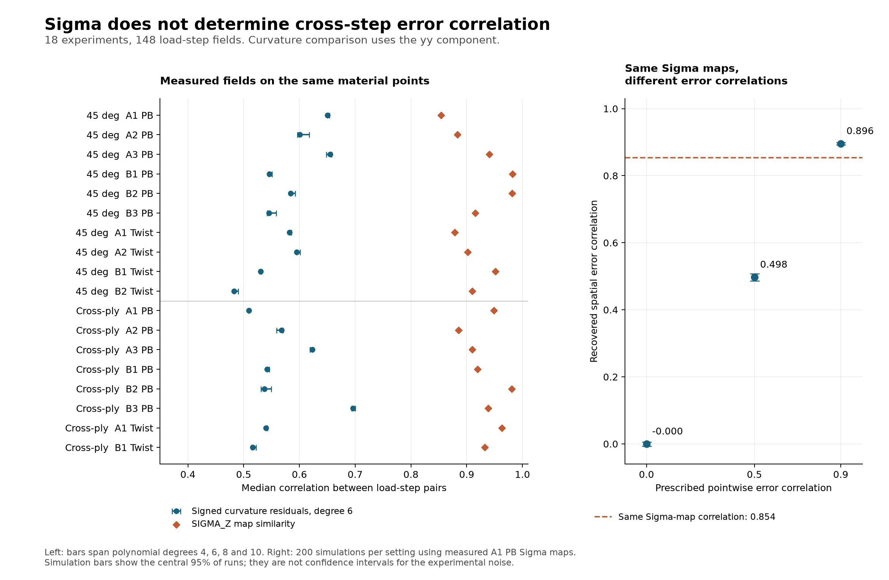
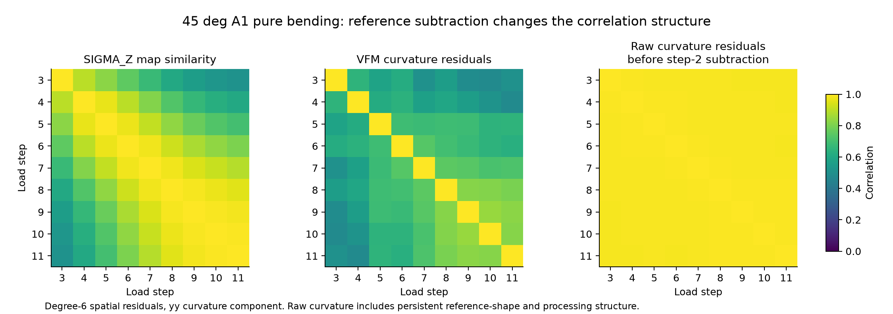

# Can raw DIC Sigma improve the FGLS load-step covariance?

## Finding

The raw uncertainty fields can inform the magnitude and spatial variation of measurement uncertainty. They do **not**, by themselves, identify the correlation of signed errors between load steps. Replacing the current residual correlation matrix with the correlation of Sigma maps is not justified by these tests.

This is a partial rejection of the proposed replacement, not a validation of the current estimator as pure measurement noise. Separating measurement noise from unrepresented mechanical structure remains necessary. The tested correlations are generally insensitive to polynomial degree, so the evidence does not support attributing most of their magnitude to the particular degree-6 choice.

## Scope and checks

Examined the implementation in `VFM Studio/Generalized VFM/vfm_noise_covariance.py`, its use in `vfm_gls_identification.py`, MAT loading, and the saved `deg45_all.vfmproj.json` and `samples_ab_all.vfmproj.json` projects. These reference raw exports outside VFM Studio, which were read only as inputs to the Studio projects.

Tested all 18 experiments in those two projects: ten 45-degree laminate experiments and eight cross-ply experiments. There are 148 selected load-step fields. Sixteen experiments have nine selected steps; the two cross-ply twist experiments have only two. Other saved projects and any unsaved GUI session are outside this numerical comparison.

Applied each saved project's rectangular virtual-mesh bounds. Matched MAT nodes to raw reference-frame X,Y coordinates, then joined all steps by the unique reference-image pixel coordinates x,y. All matches were exact. There were 74,920 retained material-point locations summed over experiments. Reconstructed the exported curvature increments from raw cxx, cyy, cxy and the step-2 reference using factors (-2,-2,+2). The largest discrepancy from the MAT fields was 2.78e-17 mm^-1.

Ran the existing covariance estimator without editing it. Independently reconstructed the degree-6 residual correlations and checked agreement with its temporal_correlation output to within 1e-10. The common covariance normalizer, including its spatial correction, cancels out of these correlation coefficients. This audit does not validate the spatial covariance propagation approximation.

## What Sigma represents

The raw exports contain `sigma`, `SIGMA_X`, `SIGMA_Y`, and `SIGMA_Z`. The supplier describes sigma in pixels as one-standard-deviation matching confidence and the metric fields as axis-specific uncertainty. These are uncertainty magnitudes, not the actual signed displacement errors. The pixel and metric fields should not be treated as independent observations of noise. See [Correlated Solutions: output variable definitions](https://correlated.kayako.com/article/28-output-variables-in-vic-2d-and-vic-3d).

The tested MAT exports omit these fields. Their FGLS kinematics are curvatures, in inverse millimeters. A metric Sigma in millimeters cannot directly replace a curvature standard deviation. Pixel-to-metric geometry, spatial differentiation/filtering, component covariance, and the reference operation must be accounted for first.

At one point, covariance between steps is

    Cov(error_t, error_s) = sigma_t * rho_ts * sigma_s.

Knowing all sigma_t values leaves rho_ts undetermined. A large correlation between Sigma maps means that locations with larger uncertainty tend to remain less certain in subsequent frames. It does not show that their signed errors move together.

## Observed comparisons

For each experiment, the reported statistic is the median Pearson correlation over distinct load-step pairs, evaluated across matching spatial points. Campaign medians below give each experiment equal weight. These are descriptive comparisons, not estimates from independent repeated noise realizations.

| Statistic | 45-degree laminate (10 experiments) | Cross-ply (8 experiments) |
|---|---:|---:|
| SIGMA_Z map correlation, campaign median | 0.913 | 0.935 |
| Range of experiment SIGMA_Z map correlations | 0.854–0.982 | 0.885–0.981 |
| Degree-6 yy-curvature residual correlation, campaign median | 0.583 | 0.541 |
| Range of experiment yy-curvature residual correlations | 0.483–0.655 | 0.510–0.696 |
| Raw yy-curvature residual correlation before step-2 subtraction, campaign median | 0.992 | 0.829 |
| Median within-frame Spearman association of SIGMA_Z with absolute yy residual | 0.072 | 0.072 |

The Sigma correlations are substantially higher than the curvature residual correlations. Their disagreement does not establish either as ground truth; it demonstrates that they measure different features of the data. The weak local magnitude association also does not rule out Sigma as a displacement-noise scale, since spatial curvature processing changes the relevant uncertainty.

Across all 54 experiment/component combinations, the median span of the experiment-level correlation statistic over polynomial degrees 4, 6, 8 and 10 was 0.016. The largest was 0.122. For yy curvature alone, the largest span was 0.021. Thus most measured correlations persist under this smoothing sensitivity test. All polynomial choices can still leave the same unresolved structure.

As an additional diagnostic, divided the curvature residuals pointwise by sqrt(SIGMA_Z_t^2 + SIGMA_Z_ref^2). The median absolute change in the experiment/component correlation statistic was 0.008, and the largest was 0.059. This is a sensitivity check of spatial weighting only; this denominator is **not** a calibrated curvature standard deviation or an established displacement-increment uncertainty.

## Controlled test of identifiability

Used the actual SIGMA_Z maps from 45-degree A1 pure bending, without changing them, and generated signed synthetic errors

    e[t,p] = sigma[t,p] * (sqrt(rho) * z_shared[p]
                          + sqrt(1-rho) * z_independent[t,p]).

The normal variables are independent except for the explicitly shared term. Every model has the same marginal standard deviation at every point and step. The prescribed pointwise cross-step correlations are 0, 0.5 and 0.9. With 200 simulations per setting and seed 20260917:

| Prescribed error correlation | Mean recovered median spatial error correlation | Central 95% of simulation runs |
|---:|---:|---:|
| 0.0 | -0.0002 | -0.0065 to 0.0051 |
| 0.5 | 0.4975 | 0.4856 to 0.5080 |
| 0.9 | 0.8958 | 0.8922 to 0.8995 |

The Sigma-map correlation stays exactly 0.854 in every setting. Slight attenuation between prescribed and recovered spatial correlations comes from the different spatial scale maps. This controlled counterexample establishes non-identifiability from Sigma alone. It is not a DIC forward simulation and does not estimate the experiments' true rho. Its percentile ranges are not experimental confidence intervals.

## Reference subtraction matters

The tested exports explicitly subtract the same step-2 curvature and displacement fields from every later step. If the underlying field errors are e_t and e_r, the increment error is e_t - e_r. In general,

    Cov(e_t-e_r, e_s-e_r)
      = Cov(e_t,e_s) - Cov(e_t,e_r) - Cov(e_r,e_s) + Var(e_r).

Under an illustrative independent-frame model, off-diagonal covariance becomes Var(e_r), and equal frame variances give correlation 1/2. This can produce substantial cross-step correlation without any serial correlation in image acquisition noise. Shared reference noise is also treated explicitly in [Besnard et al., Analysis of image series through global digital image correlation (2012)](https://journals.sagepub.com/doi/10.1177/0309324712441435).

However, the already-correlated VIC outputs share their original DIC reference. Their metric Sigma fields do not expose the full joint covariance with that reference. Simply summing exported variances and assuming independence can double-count a common contribution that re-referencing cancels. The 1/2 result is a model illustration, not a measured or prescribed correlation for these tests.

In the actual data, re-referencing **reduces** the raw curvature residual correlations, dramatically in the 45-degree laminate. This is consistent with cancelling a persistent field shared by the raw outputs, including initial shape and processing structure. Neither the raw nor the differenced spatial residuals isolate measurement noise on their own.

## Implication for FGLS

A defensible alternative would use calibrated raw uncertainty magnitudes together with an independently justified joint error model. Propagate that model through the actual reference subtraction and curvature calculation, and then through the VFM equations. For a linearized processing operator J, this takes the form C_kinematics = J C_raw J^T; C_raw must contain the relevant cross-step, spatial and component blocks. A position Sigma alone supplies only part of that information.

Keep mechanical discrepancy separate when interpreting the resulting uncertainty. It is not established here that all mechanical structure left by the smoother belongs in the covariance of VFM equation errors. The current code itself documents its estimate as an effective error covariance rather than pure DIC noise.

The decisive validation would use repeated stationary/held-load images and independently acquired reference images, or repeated image-level synthetic perturbations with known deformation, processed through the same VIC settings and export operations. Reusing one fixed reference in every repeat does not sample its uncertainty. Compare predicted and empirical covariance and, on known-answer tests, parameter-error coverage. A subsequent FGLS sensitivity study can explore plausible correlation models, but cannot establish a preferred model from Sigma alone.

No replacement FGLS fit was reported: doing so would require inventing the missing correlation and curvature-propagation assumptions. This study tests the proposed covariance source, not the accuracy of a newly identified material-property vector.

## Experiment details

Values below are medians over step pairs. Residual columns use polynomial degree 6 and the actual re-referenced MAT kinematics.

| Experiment | Steps | Points | Sigma_Z map | kxx residual | kyy residual | kxy residual |
|---|---:|---:|---:|---:|---:|---:|
| 45deg_A1_PB | 9 | 5811 | 0.854 | 0.608 | 0.650 | 0.713 |
| 45deg_A2_PB | 9 | 3319 | 0.883 | 0.586 | 0.601 | 0.507 |
| 45deg_A3_PB | 9 | 2233 | 0.941 | 0.811 | 0.655 | 0.779 |
| 45deg_B1_PB | 9 | 5247 | 0.982 | 0.483 | 0.546 | 0.553 |
| 45deg_B2_PB | 9 | 3591 | 0.982 | 0.598 | 0.584 | 0.596 |
| 45deg_B3_PB | 9 | 1679 | 0.916 | 0.408 | 0.545 | 0.502 |
| 45deg_A1_Twist | 9 | 5751 | 0.879 | 0.649 | 0.582 | 0.579 |
| 45deg_A2_Twist | 9 | 3513 | 0.902 | 0.590 | 0.595 | 0.551 |
| 45deg_B1_Twist | 9 | 5843 | 0.952 | 0.554 | 0.531 | 0.568 |
| 45deg_B2_Twist | 9 | 3801 | 0.910 | 0.509 | 0.483 | 0.561 |
| crossply_A1_PB | 9 | 5544 | 0.949 | 0.800 | 0.510 | 0.686 |
| crossply_A2_PB | 9 | 3705 | 0.885 | 0.496 | 0.568 | 0.531 |
| crossply_A3_PB | 9 | 2730 | 0.910 | 0.705 | 0.623 | 0.690 |
| crossply_B1_PB | 9 | 5180 | 0.920 | 0.509 | 0.542 | 0.629 |
| crossply_B2_PB | 9 | 3813 | 0.981 | 0.553 | 0.537 | 0.570 |
| crossply_B3_PB | 9 | 2600 | 0.939 | 0.695 | 0.696 | 0.802 |
| crossply_A1_Twist | 2 | 5280 | 0.963 | 0.595 | 0.540 | 0.550 |
| crossply_B1_Twist | 2 | 5280 | 0.932 | 0.560 | 0.516 | 0.502 |

## Reproducibility and unchanged files

`experiment_summary.json` contains per-experiment metrics and frame IDs. Per-experiment NPZ files contain the matched points, raw and exported curvatures, reference fields, Sigma arrays and calculated correlation matrices. `sigma_identifiability_simulation.json` records the seed and simulation results. `aggregate_summary.json` contains the campaign statistics. Analysis ran in separate Python processes with bytecode writes disabled.

SHA-256 comparisons verified that all 185 existing VFM Studio source and configuration files included in the audit remained unchanged. Original CSV and MAT inputs were read only. All newly saved results are confined to this result directory.
