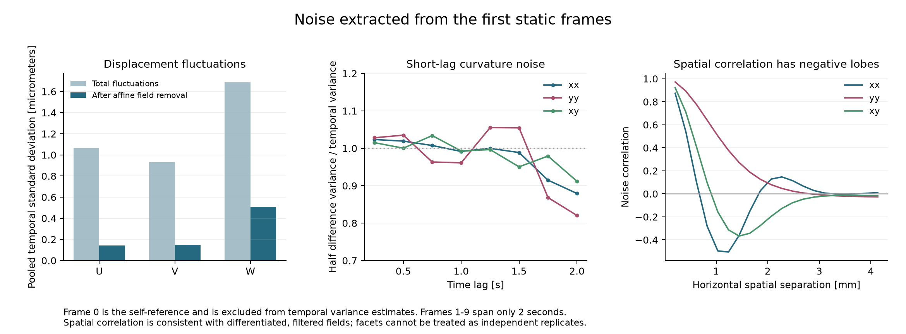
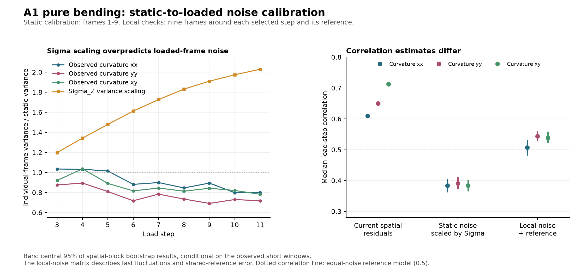
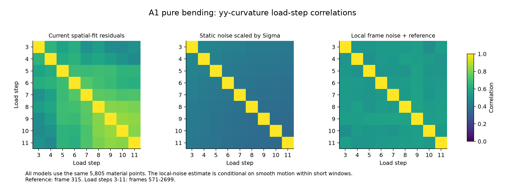

# Static-noise calibration and load-step correlation: A1 pure bending

## Answer

The static sequence provides useful measured noise parameters and strongly supports a shared-reference explanation for a substantial part of the load-step correlation. However, combining that static calibration with the exported Sigma fields using straightforward variance scaling does **not** pass the check against fluctuations observed during loading.

Using neighboring frames around each load step and the actual VFM reference gives a defensible **fast-noise covariance estimate**. Its median step correlations are 0.507, 0.544 and 0.538 for the xx, yy and xy curvature channels. These estimates remain conditional on the short-window assumptions; the first ten static frames cannot establish the covariance of slow drift over the full experiment.

## Data and treatment of the first ten frames

Source: `D:/Multiaxial_Testing_Machine/Post_VFM_Conference/45_deg Laminate/Specimen_A1_PB`.

Interpreted the first ten files as frames 0-9. Frame 0 is the DIC self-reference: all its displacements are identically zero. It is not an independent repeat for estimating temporal variance. The primary variance estimates therefore use the nine independently acquired frames 1-9. Frames 1-10 were also analyzed as an endpoint sensitivity check. Frame 0 remains useful for studying reference subtraction and initial shape; its absolute curvature is not zero.

Used the exact A1_PB ROI and selected steps from VFM Studio's saved `deg45_all.vfmproj.json` project, as in the earlier audit. Matched material points using reference X,Y and then unique pixel x,y keys. Six of the previous 5,811 points were absent in at least one neighboring loaded frame, leaving a common 5,805-point ROI. No values were interpolated.

Read 101 distinct CSV files: the initial sequence plus nine-frame windows around reference frame 315 and loaded frames 571, 827, 1083, 1339, 1595, 1859, 2111, 2375 and 2699. Windows use offsets -5 through +3 because the recording ends at frame 2702. The synchronized machine/DIC table establishes 0.25 seconds per frame. Independent static frames 1-9 span 2 seconds. Selected load steps are 63-81 seconds apart and span 532 seconds.

The VFM curvature convention is (-2*cxx, -2*cyy, +2*cxy). Subtracting frame 315 reconstructs the existing MAT curvature fields to round-off precision. No DIC re-correlation was performed; these are analyses of the supplied processed DIC exports.

## Extracted static noise

At each material point, subtract the mean over frames 1-9. Pool the resulting temporal covariance over spatial points using 8 temporal degrees of freedom. This removes the fixed initial shape and fixed original-reference contribution. It estimates fluctuations between target frames, rather than the total uncertainty of an increment containing a noisy reference.

| Channel | Pooled temporal standard deviation | After removing an affine spatial field per frame |
|---|---:|---:|
| U | 1.063 micrometers | 0.141 micrometers |
| V | 0.934 micrometers | 0.149 micrometers |
| W | 1.686 micrometers | 0.508 micrometers |
| kxx | 6.297e-4 mm^-1 | 6.259e-4 mm^-1 |
| kyy | 5.501e-4 mm^-1 | 5.499e-4 mm^-1 |
| kxy | 6.084e-4 mm^-1 | 6.081e-4 mm^-1 |

The displacement fluctuations contain a substantial coherent/affine contribution. The images alone cannot distinguish actual small specimen/camera motions from optical or reconstruction drift. Removing an affine spatial field is a diagnostic, not proof that everything removed is measurement error. The curvature estimates barely change under that operation.

The static individual-frame curvature covariance, ordered (kxx, kyy, kxy), is approximately

    S_static = 1e-7 * [[3.96541,  0.61776,  0.11120],
                      [0.61776,  3.02614, -0.02093],
                      [0.11120, -0.02093,  3.70121]] mm^-2.

Corresponding component correlations are 0.178 for xx/yy, 0.029 for xx/xy, and -0.006 for yy/xy. These are spatially averaged same-point covariances, not the full covariance between every pair of facets.

### Static consistency checks

- Adding frame 10 changes the three curvature standard deviations by only 0.33%, 0.29% and 0.53%.
- The first-difference estimate sqrt(mean((k[t+1]-k[t])^2)/2) gives 6.371e-4, 5.578e-4 and 6.130e-4 mm^-1, close to the temporal standard deviations. This is consistent with little short-lag curvature correlation, but nine frames are insufficient for a precise temporal-correlation law.
- Median spatial correlations between non-overlapping frame differences are 0.011, 0.020 and 0.028 for the three curvature channels. This avoids both a shared differencing reference and the artificial negative dependence introduced by temporal mean subtraction.
- With frame 0 as the common reference, the measured static curvature-increment correlations are 0.521, 0.495 and 0.535. Re-referencing to other static frames gives similar values near one half.

The exported static metric Sigma RMS values are 0.200, 0.203 and 0.736 micrometers for X,Y,Z. Their values divided by sqrt(2) agree with the affine-removed individual-frame displacement fluctuations to approximately 0%, 4% and 2.5%, respectively. This supports an equal-reference/target-noise interpretation in the **static** configuration. It does not establish the same decomposition under deformation.

### Spatial correlation

Neighboring facets are strongly correlated. At about 0.2 mm spacing, curvature correlations range from 0.844 to 0.972 depending on direction and component. Differentiation produces negative lobes: at approximately 1 mm, horizontal kxx correlation is -0.496 and vertical kyy correlation is -0.655. Correlations are much smaller by roughly 3 mm.

Consequently, a single positive spatial correlation length or an independent-facet model is insufficient for accurate propagation to VFM equations. The supplied spatial-correlation diagnostics retain the direction and component dependence. A complete spatial covariance has not been identified from nine repeats.

## Combining static and loaded information

For individual-frame curvature errors eta_t, define a VFM increment error as eta_t-eta_r, where r is frame 315. Its covariance is

    Gamma_ts = C_ts - C_tr - C_rs + C_rr.

If independent target-frame errors are a suitable approximation,

    Gamma_ts = S_r                  for t != s,
    Gamma_tt = S_t + S_r.

For a scalar curvature component,

    rho_ts = v_r / sqrt((v_t+v_r)*(v_s+v_r)).

This makes the role of per-load information clear: it should estimate the individual-frame variances v_t and the reference variance v_r, rather than correlate maps of positive standard deviations. Equal frame variances give rho=0.5.

### Test 1: scale static covariance by Sigma

Constructed pointwise static component covariance estimates and scaled them by

    b_t(p) = SIGMA_Z_t(p)^2 / mean_static(SIGMA_Z(p)^2).

Used the same scaling for the VFM reference frame, assembled a positive-semidefinite shared-reference covariance, and pooled over the same material points. This assumes that changes in Sigma_Z transfer proportionally to curvature-noise variance with unchanged processing behavior. It is a candidate model, not an identity.

A second candidate accounted for an assumed constant original-reference contribution using b_t=2*(Sigma_t^2/Sigma_static^2)-1. It performed worse in correlation prediction, giving medians of 0.320, 0.328 and 0.319. The static images do not justify a unique reference/target split at loaded configurations.

### Test 2: measure local noise at each loaded configuration

For each selected load step and frame 315, fitted a linear time trend independently at each material point using the nine surrounding frames. The residuals estimate fast fluctuations after removing a locally smooth mechanical response. Used seven temporal residual degrees of freedom.

To estimate cross-step covariance, paired equal offsets within the separated windows, subtracted the reference-window residual from each target-window residual, and formed the Gram matrix across offsets and material points. This directly yields a positive-semidefinite 27x27 step/component covariance. It includes estimated cross-frame terms rather than forcing them to zero.

This procedure assumes local stationarity and sufficiently smooth mechanics within each two-second window. The windows contain measurable motion; they have **not** been relabeled as static acquisitions. Unknown fast physical motion is inseparable from measurement fluctuation in this calculation. Temporal detrending suppresses slow variation, including slow correlated errors.

## Results

| Method | Median rho, kxx | Median rho, kyy | Median rho, kxy |
|---|---:|---:|---:|
| Current degree-6 spatial-fit residuals | 0.609 | 0.650 | 0.713 |
| Equal static noise + shared reference | 0.500 | 0.500 | 0.500 |
| Static noise scaled by Sigma_Z | 0.384 | 0.391 | 0.384 |
| Measured local variances, independent-frame approximation | 0.511 | 0.542 | 0.541 |
| Measured local covariance including cross-frame terms | 0.507 | 0.544 | 0.538 |

Each entry is the median over the 36 distinct pairs among load steps 3-11. These are component-specific summary values, not a recommendation to fill every off-diagonal matrix entry with that median. The complete matrices are saved separately.

The measured local covariance gives pairwise ranges of 0.449-0.555, 0.499-0.577 and 0.495-0.580 for xx, yy and xy. Before VFM reference subtraction, its median inter-window correlations are -0.003, -0.009 and -0.008. Agreement with the independent-frame approximation supports a shared-reference model for the **fast** fluctuation component.

The Sigma_Z variance ratio rises from 1.20 at the first loaded step to 2.03 at the final step, relative to the initial static baseline. In contrast, observed local yy-curvature variance is 0.88 of the static value at the first loaded step and 0.72 at the final step. The other curvature components also remain similar or decrease. Pointwise Sigma scaling overpredicts individual-frame curvature-noise variance by factors of approximately 1.14-2.82 across the tested steps and components. Because it increases target variances relative to the reference, it predicts correlations that are too small compared with the measured local fluctuation covariance.

Thus, the static Sigma calibration is encouraging for displacement noise at rest, but its simple transfer to loaded curvature noise is contradicted by the neighboring-frame measurements. These data do not identify whether the mismatch comes mainly from geometric sensitivity, matching bias under deformation, changing spatial filtering, or another source.

The existing spatial-fit residual covariance also differs materially from the fast-noise covariance. Its marginal variances are about 1.1-3.5 times the independent local-noise estimate. Its median correlations are higher, but individual pairs need not be: it has a different correlation pattern. The excess cannot automatically be classified as mechanical discrepancy; slower correlated error and unmodeled noise can also contribute. Subtracting the two matrices is not an established way to obtain a physical discrepancy covariance.

## Robustness and limits

Changing the local temporal fit from linear to quadratic gives correlation medians 0.501, 0.536 and 0.535. Cubic fits give 0.510, 0.532 and 0.536. Quadratic-versus-linear local curvature variance ratios remain approximately 0.94-1.04. Removing one offset at a time gives median-correlation ranges 0.490-0.514, 0.535-0.552 and 0.531-0.545.

Spatial-block bootstrap with 30 blocks approximately 3 mm across and 400 resamples gives central 95% ranges of 0.481-0.532, 0.527-0.561 and 0.521-0.558 for the local-noise medians. The Sigma-scaled model gives 0.362-0.406, 0.372-0.411 and 0.365-0.402. Approximately 2 mm blocks give similar results. These ranges describe sensitivity to the sampled spatial region conditional on the observed windows; they are **not** confidence intervals covering all temporal uncertainty, drift, reference-model error, or changes in the physical experiment.

The strongest unresolved issue is time scale. The static calibration covers two seconds; real load-step spacings are about a minute. The neighboring-frame analysis checks the covariance of fast fluctuations at those separated configurations, but detrending removes their slowly varying parts. The total load-step error correlation therefore remains unidentifiable without additional assumptions or independent longer stationary/reference measurements.

## Recommended use

Use the local variance/shared-reference model as a candidate for the fast measurement-noise part of Gamma. The static sequence validates its basic mechanism and supplies an independent baseline. Prefer measured local variances to the tested Sigma scaling. Retain the explicit reference operation and cross-component covariance. Account for the measured spatial correlation before propagating this covariance through the VFM equations.

For a full noise model, add a separately validated slow-drift contribution using longer stationary acquisitions and repeated reference realizations. Do not present the current 27x27 estimate as the complete error covariance or as a validated replacement for all effective-error terms in FGLS. No material-parameter fit, application modification, or DIC reprocessing was performed in this study.

## Per-frame curvature standard deviations

These are individual-frame fast-fluctuation estimates after local linear time detrending, before subtraction of the VFM reference. Units are mm^-1.

| Role / load step | Frame | sigma_kxx | sigma_kyy | sigma_kxy |
|---|---:|---:|---:|---:|
| VFM reference | 315 | 0.000614324 | 0.000523926 | 0.000609541 |
| 3 | 571 | 0.000640479 | 0.000514684 | 0.000583609 |
| 4 | 827 | 0.000639507 | 0.000520267 | 0.000619336 |
| 5 | 1083 | 0.000634504 | 0.000494933 | 0.000574231 |
| 6 | 1339 | 0.000591191 | 0.00046611 | 0.000549701 |
| 7 | 1595 | 0.000597218 | 0.0004871 | 0.000559133 |
| 8 | 1859 | 0.000579135 | 0.000471582 | 0.00054867 |
| 9 | 2111 | 0.000595465 | 0.000457371 | 0.000558423 |
| 10 | 2375 | 0.000562631 | 0.00047007 | 0.000551088 |
| 11 | 2699 | 0.000563614 | 0.000466073 | 0.000538211 |

## Files and integrity

- `load_step_matrices.json`: readable 9x9 correlation matrices for all three components and full 27x27 step-major covariance matrices; ordering is (step 3 kxx, kyy, kxy, step 4 kxx, ...).
- `load_step_covariance_models.npz`: numerical covariance models and their per-frame inputs.
- `noise_summary.json` and `static_diagnostics.json`: static parameters, reference checks, and spatial/temporal diagnostics.
- `robustness.json`: resampling and omitted-offset sensitivity results.
- `aligned_inputs.npz`: the matched input arrays and exact frame/ROI selection.
- `input_metadata.json`, `input_hashes.json`, and `integrity_check.json`: source tracking and verification.

Verified that all 177 checked existing Python/TOML source files and all 101 input CSVs read for this analysis remained byte-for-byte unchanged. The maximum discrepancy when reconstructing existing MAT curvature fields was 2.6e-18 mm^-1. Only new analysis artifacts were written in this directory. Python bytecode writes were disabled.
